# Azure & Active Directory Lab: Domain Controller, Users, Groups and Delegated Administration

A hands-on project that builds a Windows Server 2022 domain controller in Microsoft Azure, then uses **Active Directory Domain Services (AD DS)** to manage users, security groups, password policy, delegated administration and permissions on a shared folder.

Every step below is backed by a numbered screenshot (**Figure 1 to Figure 58**) stored in the [`images/`](images/) folder.

---

## Table of Contents

- [Project Overview](#project-overview)
- [Environment Summary](#environment-summary)
- [Task 1: Azure Resources and Active Directory Installation (20 points)](#task-1-azure-resources-and-active-directory-installation-20-points)
  - [1.1 Create the resource group](#11-create-the-resource-group)
  - [1.2 Deploy the Windows Server 2022 VM](#12-deploy-the-windows-server-2022-vm)
  - [1.3 Connect to the VM with RDP](#13-connect-to-the-vm-with-rdp)
  - [1.4 Install the AD DS role](#14-install-the-ad-ds-role)
  - [1.5 Promote the server to a domain controller](#15-promote-the-server-to-a-domain-controller)
- [Task 2: User Accounts and Delegated Administration (15 points)](#task-2-user-accounts-and-delegated-administration-15-points)
  - [2.1 Create organizational units](#21-create-organizational-units)
  - [2.2 Create user accounts](#22-create-user-accounts)
  - [2.3 Assign users to security groups](#23-assign-users-to-security-groups)
  - [2.4 Delegation of Control](#24-delegation-of-control)
  - [2.5 Enforce password policies](#25-enforce-password-policies)
- [Task 3: Group-Based Access Control with Delegation (15 points)](#task-3-group-based-access-control-with-delegation-15-points)
  - [3.1 Create manager accounts](#31-create-manager-accounts)
  - [3.2 Create department security groups](#32-create-department-security-groups)
  - [3.3 Add users to the groups](#33-add-users-to-the-groups)
  - [3.4 Delegate group membership management](#34-delegate-group-membership-management)
  - [3.5 Configure permissions on a shared folder](#35-configure-permissions-on-a-shared-folder)
- [Final Directory Layout](#final-directory-layout)
- [Security Notes and Improvements](#security-notes-and-improvements)
- [Cleanup](#cleanup)
- [Skills Demonstrated](#skills-demonstrated)

---

## Project Overview

A fictional organization needs a central identity system for its employees. The goals of this project are to:

1. **Deploy** a secure, scalable infrastructure in Azure, with a Windows Server 2022 VM hosting AD DS to manage users, groups and resources.
2. **Streamline user onboarding** by creating accounts and placing them in the right security groups, while **delegating** routine tasks to department administrators so central IT is not a bottleneck.
3. **Control access to internal resources** with department security groups, delegated group-membership management and least-privilege folder permissions.

## Environment Summary

| Item | Value |
|---|---|
| Cloud platform | Microsoft Azure |
| Resource group | `glwipro27` |
| Region | East US |
| Virtual machine | `glwiproadvm27` |
| Operating system | Windows Server 2022 Datacenter |
| VM administrator | `glwiproadmin` |
| Remote access | RDP, TCP port 3389 |
| AD domain / forest | `company.local` (NetBIOS name `COMPANY`) |
| Functional levels | Windows Server 2012 R2 (forest and domain) |
| Services on the DC | AD DS, DNS server, Global Catalog |
| Organizational units | `HR`, `IT`, `SALES` |
| Group Policy Object | `PASSWORDS` |

---

# Task 1: Azure Resources and Active Directory Installation (20 points)

## 1.1 Create the resource group

A resource group is the logical container for everything in this lab, so the whole environment can be managed and deleted together. The group `glwipro27` was created in the **East US** region.

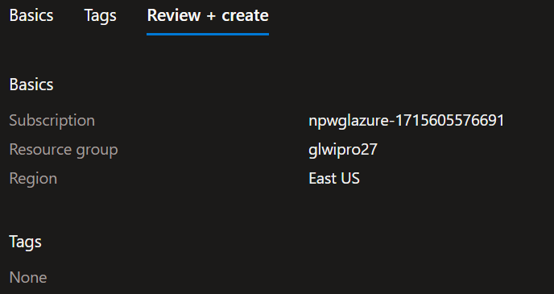
*Figure 1: Review + create summary showing subscription, resource group glwipro27 and region East US*

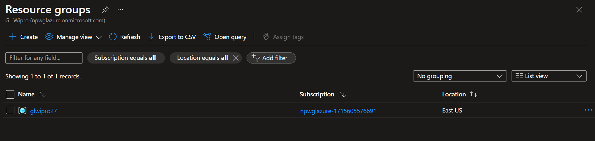
*Figure 2: Azure Resource groups list showing glwipro27 in East US*

## 1.2 Deploy the Windows Server 2022 VM

Inside the resource group, a **Windows Server 2022 Datacenter** virtual machine named `glwiproadvm27` was deployed in East US with a self-selected availability zone.

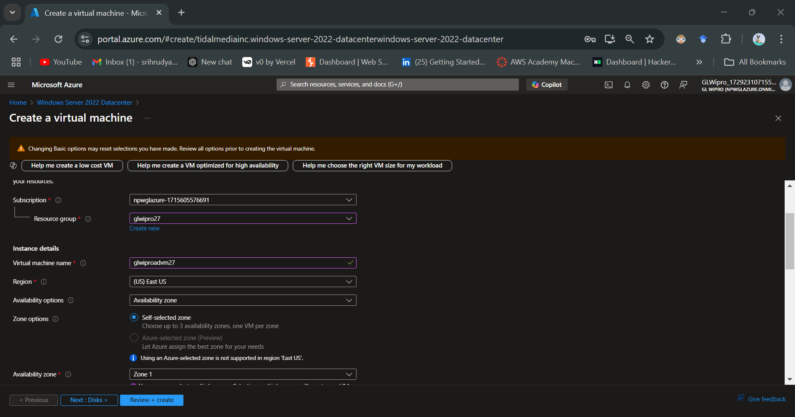
*Figure 3: Create a virtual machine page with the Windows Server 2022 Datacenter image, resource group and instance details*

The administrator account (`glwiproadmin`) and its password were set in the **Administrator account** section. These credentials are used for the first RDP login.

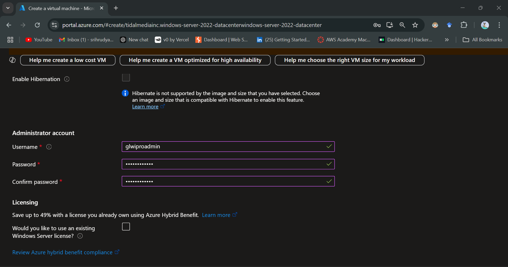
*Figure 4: Administrator account section with username glwiproadmin and password fields*

After deployment, the Azure home page lists both the new virtual machine and the resource group under **Recent resources**.

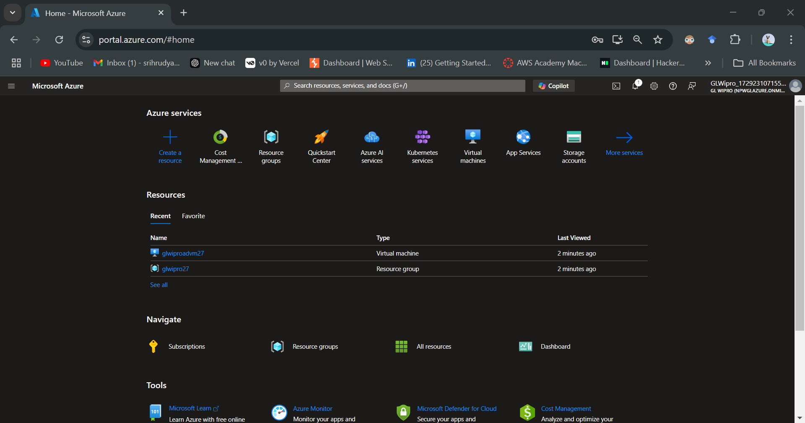
*Figure 5: Azure home page listing the new virtual machine and resource group*

## 1.3 Connect to the VM with RDP

On the VM's **Connect** blade, **Native RDP** was selected. The page shows the public IP address, the admin username and port **3389**.

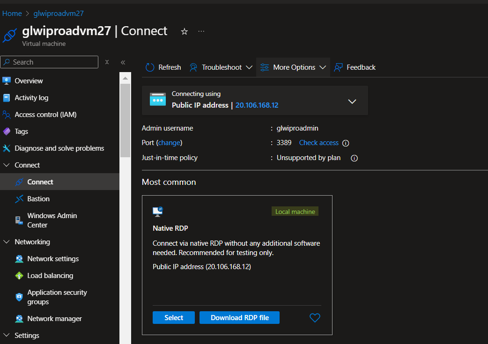
*Figure 6: VM Connect blade with the Native RDP option, public IP address and port 3389*

Opening the downloaded RDP file triggers two expected warnings, because the VM uses a self-signed certificate and an unknown publisher. For a lab these can be accepted.

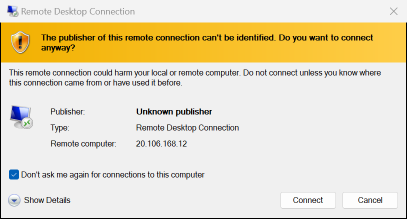
*Figure 7: Remote Desktop Connection warning about an unknown publisher*

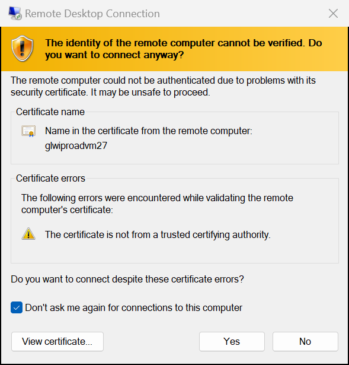
*Figure 9: Remote Desktop Connection certificate warning, certificate is not from a trusted certifying authority*

Windows then asks for the VM credentials.

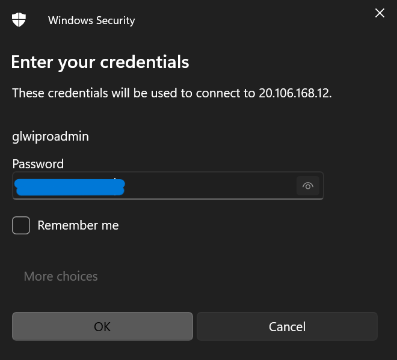
*Figure 10: Windows Security prompt asking for the administrator credentials*

After signing in, the desktop loads with **Server Manager**. Windows asks whether to allow discovery on the network.

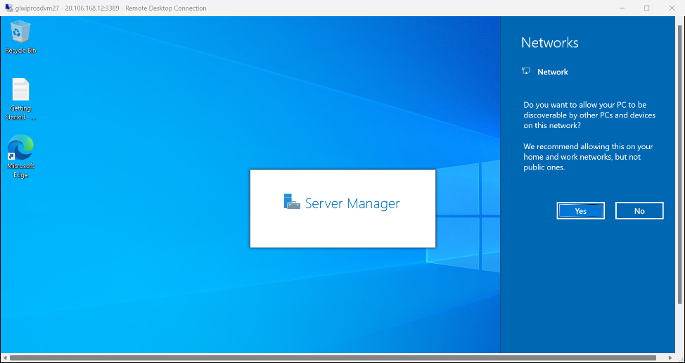
*Figure 8: Remote Desktop session showing Server Manager starting and the Networks prompt*

## 1.4 Install the AD DS role

From **Server Manager > Manage > Add Roles and Features**, the **Add Roles and Features Wizard** was used.

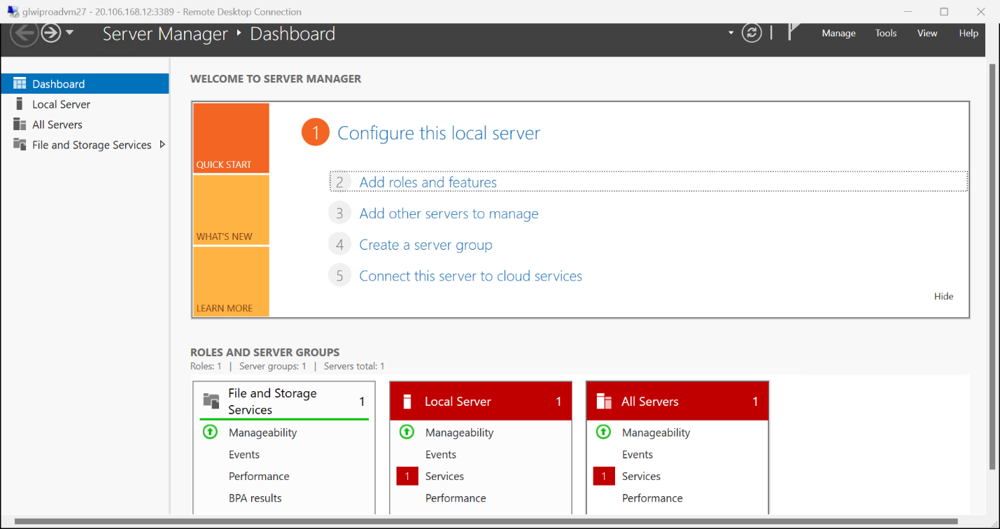
*Figure 11: Server Manager dashboard with the Add roles and features link*

When **Active Directory Domain Services** is ticked on the *Select server roles* page, the wizard offers the required management tools. **Include management tools** was kept ticked.

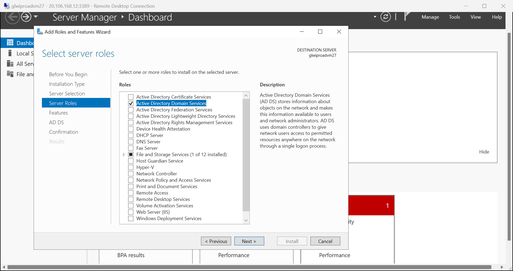
*Figure 13: Select server roles page with Active Directory Domain Services ticked*

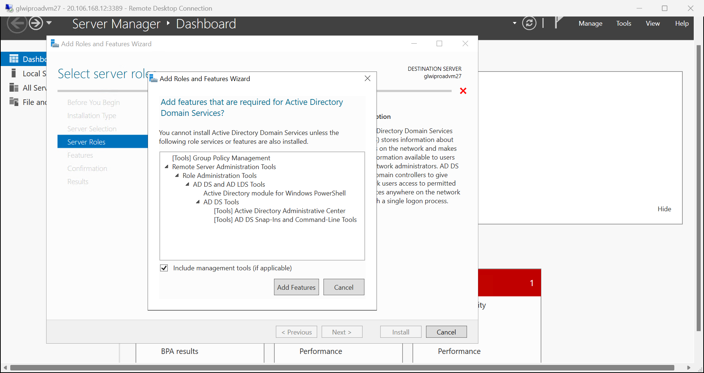
*Figure 12: Dialog listing the features required for Active Directory Domain Services*

The *Confirmation* page lists everything that will be installed: AD DS, Group Policy Management and the AD administration tools (AD Administrative Center and the AD DS snap-ins and command-line tools).

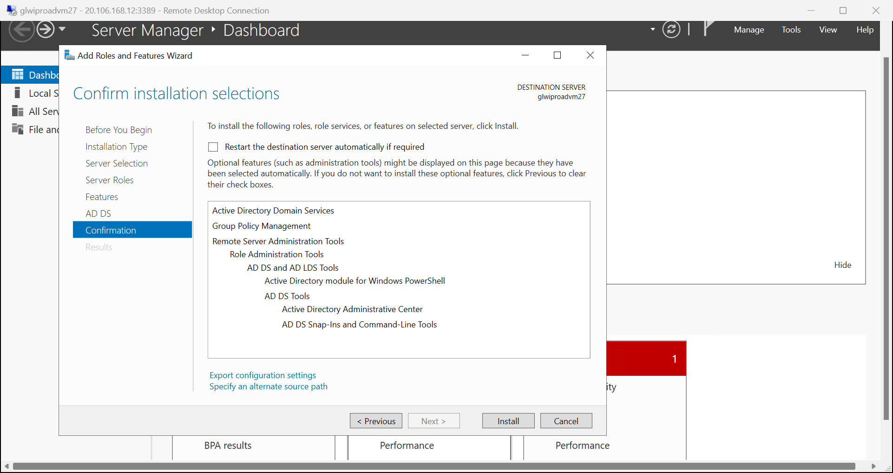
*Figure 14: Confirm installation selections page*

The *Results* page reports that the installation succeeded and offers **Promote this server to a domain controller**.

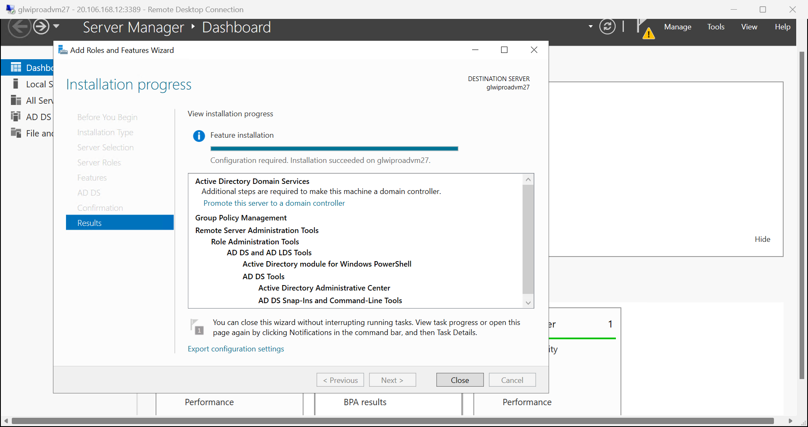
*Figure 15: Installation progress page showing the AD DS feature installed successfully*

**PowerShell equivalent (optional):**

```powershell
Install-WindowsFeature -Name AD-Domain-Services -IncludeManagementTools
```

## 1.5 Promote the server to a domain controller

The promotion wizard creates a brand-new forest. **Add a new forest** was selected with the root domain name `company.local`.

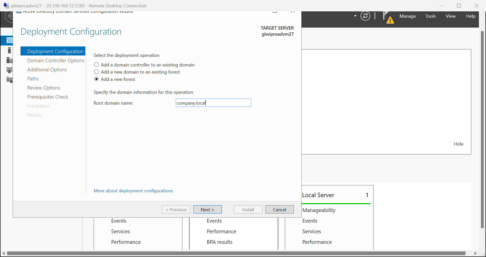
*Figure 16: Deployment Configuration page with Add a new forest and root domain name company.local*

On **Domain Controller Options**, the forest and domain functional levels were left at **Windows Server 2012 R2**. **DNS server** and **Global Catalog** were ticked, and a **Directory Services Restore Mode (DSRM)** password was set.

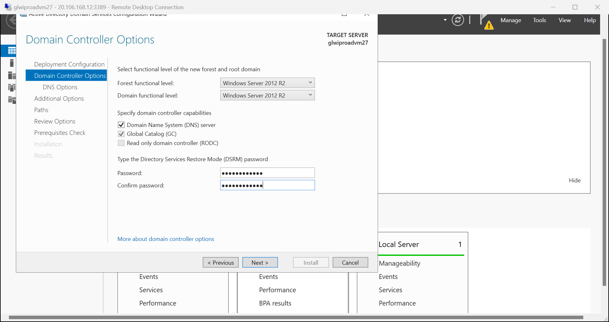
*Figure 17: Domain Controller Options page showing functional levels, DNS, Global Catalog and DSRM password*

The **Review Options** page summarizes the configuration: new forest `company.local`, NetBIOS name `COMPANY`, and the database, log and SYSVOL folders under `C:\Windows`.

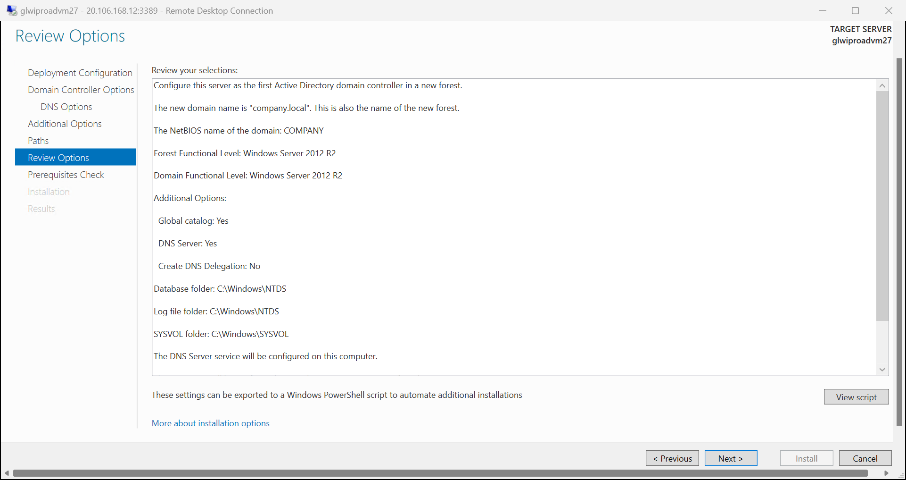
*Figure 18: Review Options page summarizing the new forest company.local*

The **Prerequisites Check** passed, and clicking **Install** promoted the server and restarted it automatically.

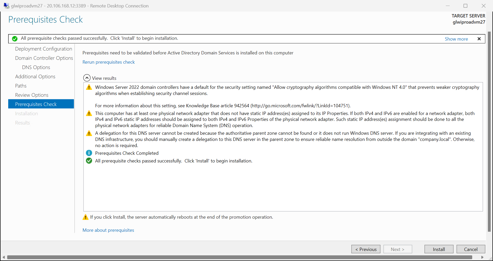
*Figure 19: Prerequisites Check page showing all prerequisite checks passed*

**PowerShell equivalent (optional):**

```powershell
Install-ADDSForest `
  -DomainName "company.local" `
  -DomainNetbiosName "COMPANY" `
  -ForestMode Win2012R2 -DomainMode Win2012R2 `
  -InstallDns `
  -SafeModeAdministratorPassword (Read-Host -AsSecureString "DSRM password")
```

> **Objective:** Deploy a secure and scalable infrastructure in Azure, where the Windows Server 2022 VM hosts Active Directory Domain Services for managing users, groups and resources.

---

# Task 2: User Accounts and Delegated Administration (15 points)

**Context:** The organization uses Active Directory for internal identity management. Employee accounts must be created with access to shared network resources, and some user-management work should be delegated to department administrators to reduce the central IT workload.

## 2.1 Create organizational units

After the reboot, **Active Directory Users and Computers** was opened from **Server Manager > Tools**.

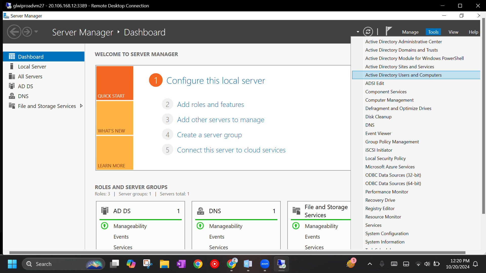
*Figure 20: Server Manager Tools menu with Active Directory Users and Computers highlighted*

Three organizational units (OUs) were created under `company.local`, one per department: **HR**, **IT** and **SALES**. Each OU keeps *Protect container from accidental deletion* ticked. OUs matter because permissions and delegation can be scoped to them.

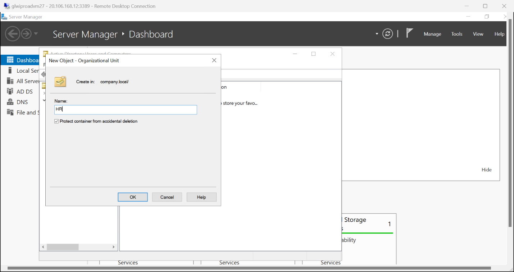
*Figure 21: New Object Organizational Unit dialog creating the HR OU*

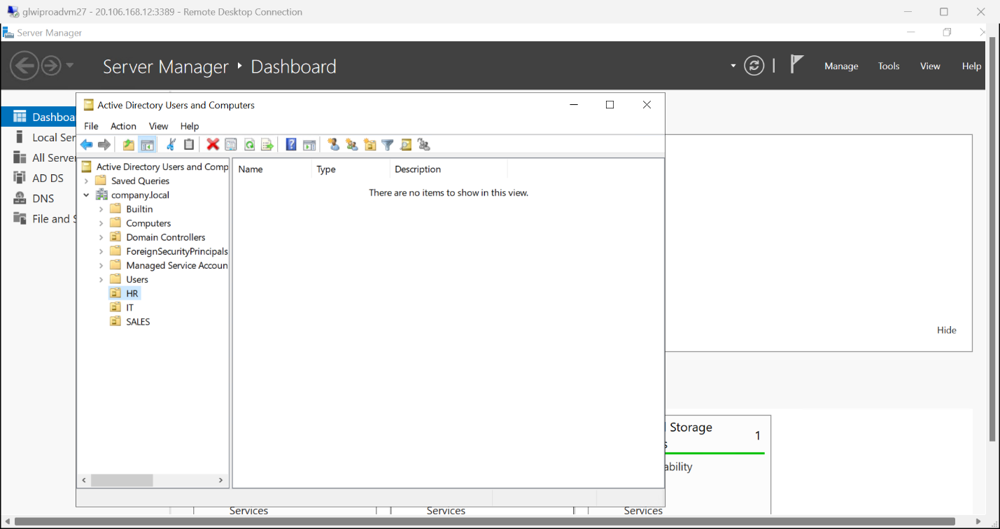
*Figure 22: Active Directory Users and Computers showing the HR, IT and SALES OUs under company.local*

## 2.2 Create user accounts

Users are created by right-clicking an OU and choosing **New > User**.

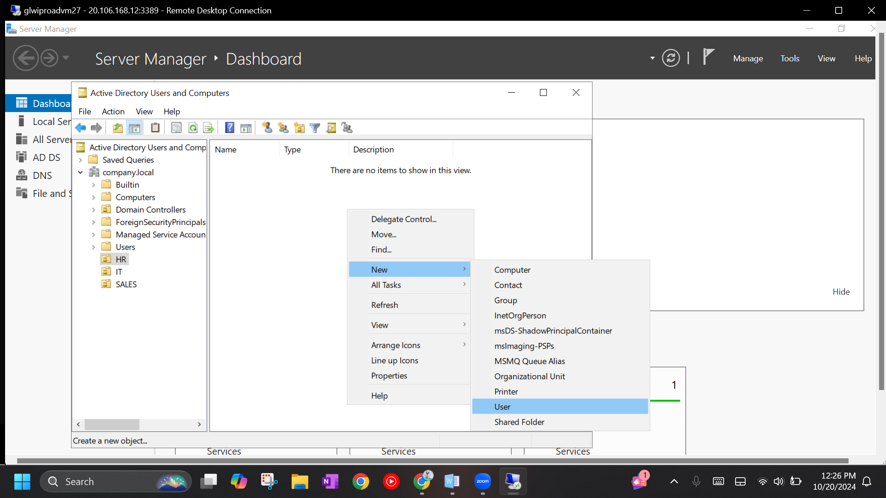
*Figure 23: Right-click menu on the HR OU with New and User selected*

The first account in each department is an admin account. For HR, the full name is `HR ADMIN` and the logon name is `hr_admin@company.local`, with the pre-Windows 2000 name `COMPANY\hr_admin`.

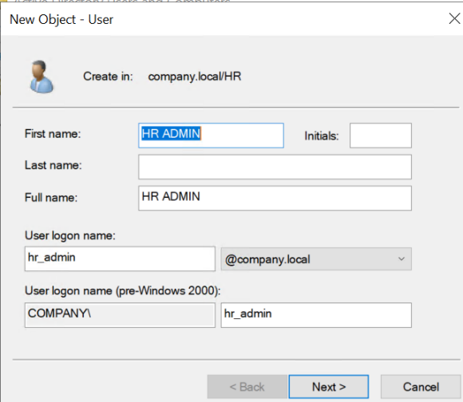
*Figure 24: New Object User dialog for HR ADMIN with logon name hr_admin@company.local*

An initial password is set and **User must change password at next logon** is ticked, so the person who knows the temporary password has to replace it on first sign-in.

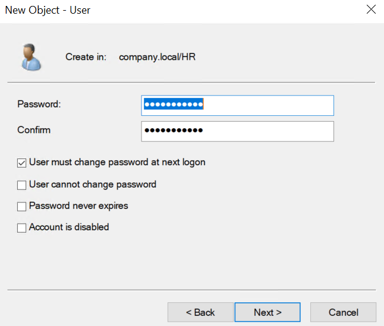
*Figure 25: New Object User password page with User must change password at next logon ticked*

The same process was repeated for each department. Each OU now contains an admin account and a standard employee account:

| OU | Admin account | Employee account |
|---|---|---|
| HR | HR ADMIN | HR01 |
| IT | IT ADMIN | IT01 |
| SALES | SALES ADMIN | SALES01 |

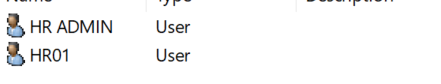
*Figure 26: HR OU containing HR ADMIN and HR01*


*Figure 27: IT OU containing IT ADMIN and IT01*

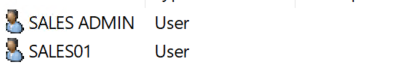
*Figure 28: SALES OU containing SALES ADMIN and SALES01*

## 2.3 Assign users to security groups

Both users in an OU were selected, then right-clicked and **Add to a group...** was chosen.

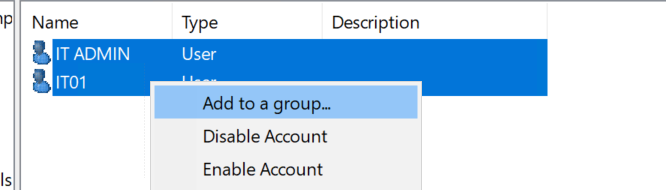
*Figure 29: Context menu with Add to a group for IT ADMIN and IT01*

`Domain Users` was entered in the **Select Groups** dialog. Typing only part of a name (`domain`) returns a **Multiple Names Found** list, from which the correct group is picked.

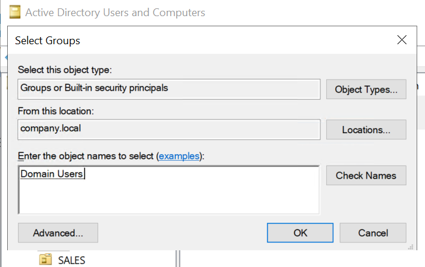
*Figure 30: Select Groups dialog with Domain Users entered*

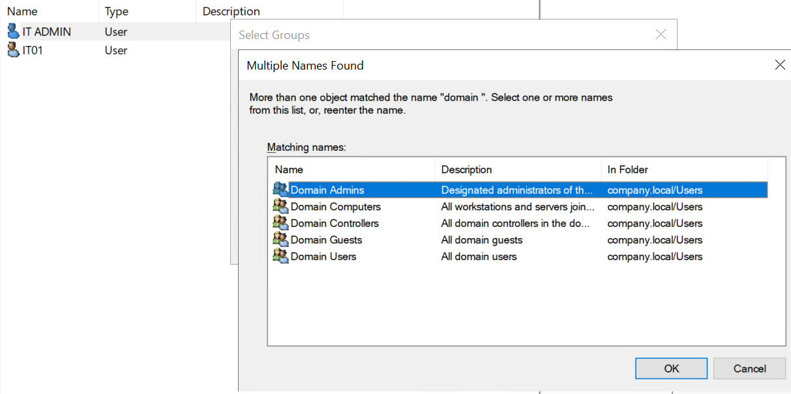
*Figure 31: Multiple Names Found dialog listing the Domain groups*

AD confirms that the operation completed.

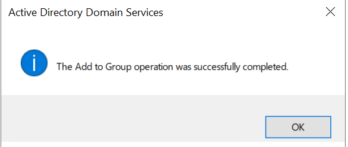
*Figure 32: Active Directory Domain Services message: The Add to Group operation was successfully completed*

> `Domain Users` is the built-in group that gives members basic access to common network resources such as shared drives and printers. New accounts are normally added to it automatically.

## 2.4 Delegation of Control

The **Delegation of Control Wizard** lets central IT hand out narrow administrative rights, such as resetting passwords or unlocking accounts, on a single OU **without** making anyone a Domain Admin. It is demonstrated in [Task 3, section 3.4](#34-delegate-group-membership-management) (Figures 50 to 53), where the same wizard is used to delegate group-membership management on the IT OU.

## 2.5 Enforce password policies

Password rules were enforced through **Group Policy**. **Group Policy Management** was opened from **Server Manager > Tools**.

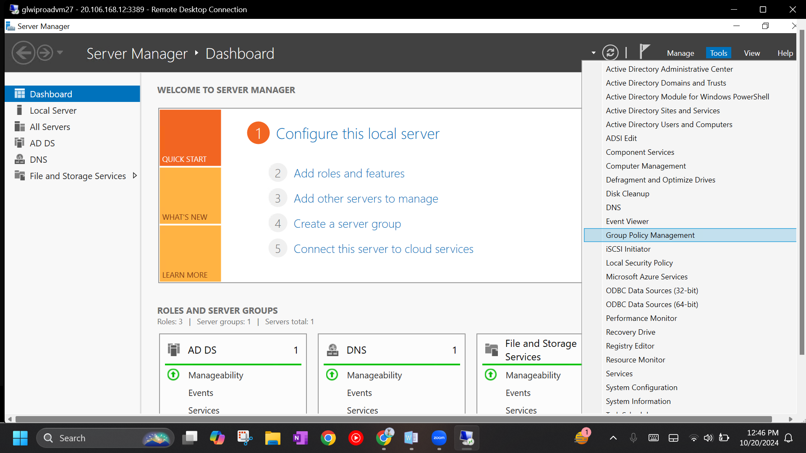
*Figure 33: Server Manager Tools menu with Group Policy Management highlighted*

A new GPO was created in the **Group Policy Objects** container.

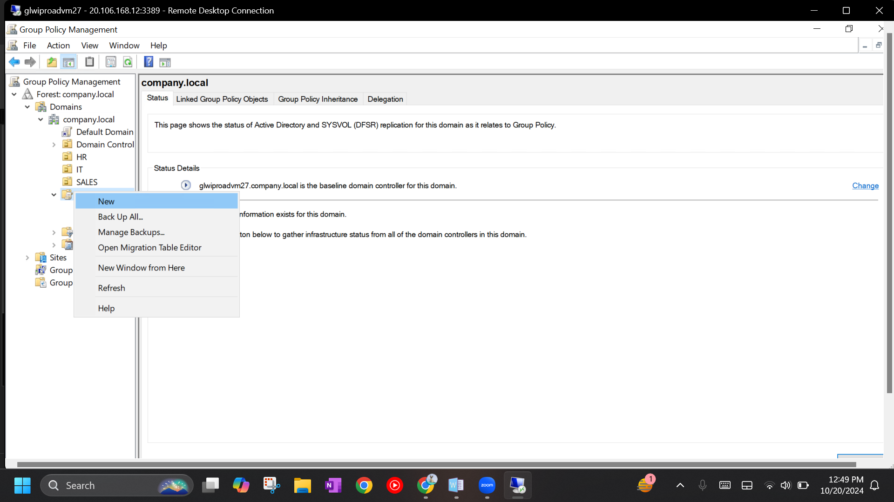
*Figure 34: Group Policy Management right-click menu with New selected*

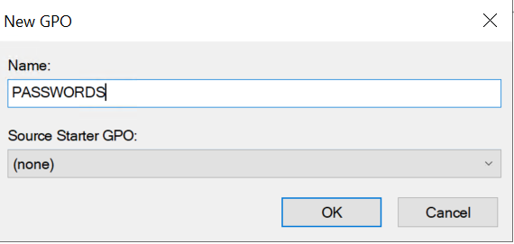
*Figure 35: New GPO dialog with the name PASSWORDS*

The GPO's **Delegation** tab shows who can read and edit it: Authenticated Users (read), Domain Admins, Enterprise Admins and SYSTEM (edit, delete, modify security), and Enterprise Domain Controllers (read).

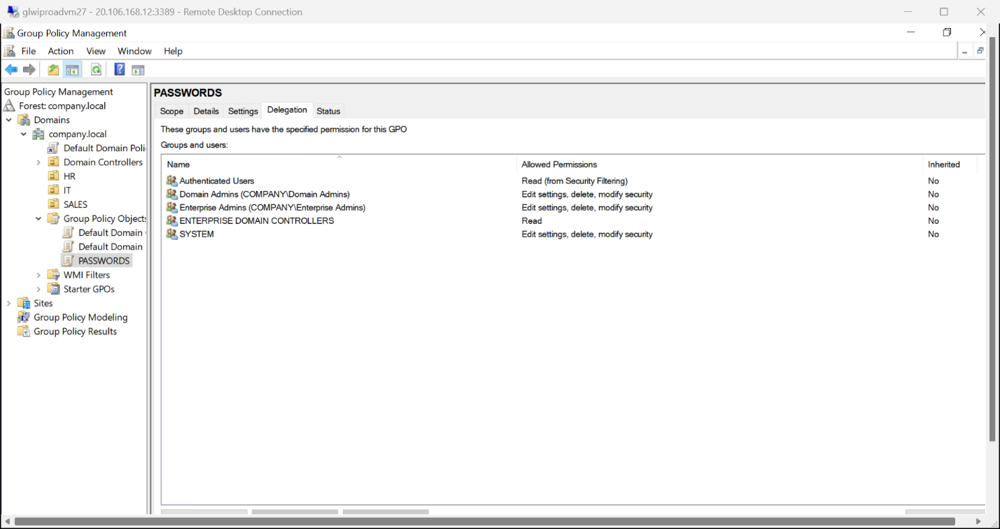
*Figure 36: PASSWORDS GPO Delegation tab showing groups and permissions*

**Edit...** opens the Group Policy Management Editor, where the settings are under **Computer Configuration > Policies > Windows Settings > Security Settings > Account Policies > Password Policy**.

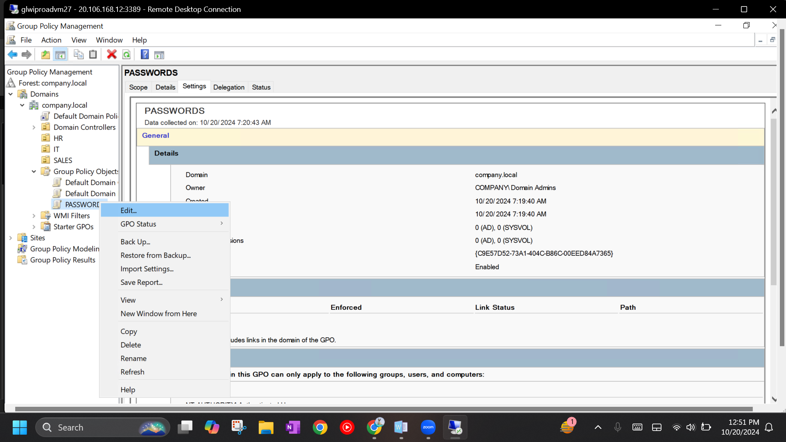
*Figure 37: Right-click menu on the PASSWORDS GPO with Edit selected*

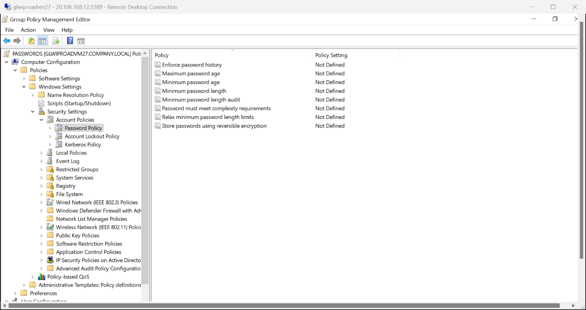
*Figure 38: Group Policy Management Editor showing the Password Policy settings*

**Password must meet complexity requirements** was set to **Enabled**.

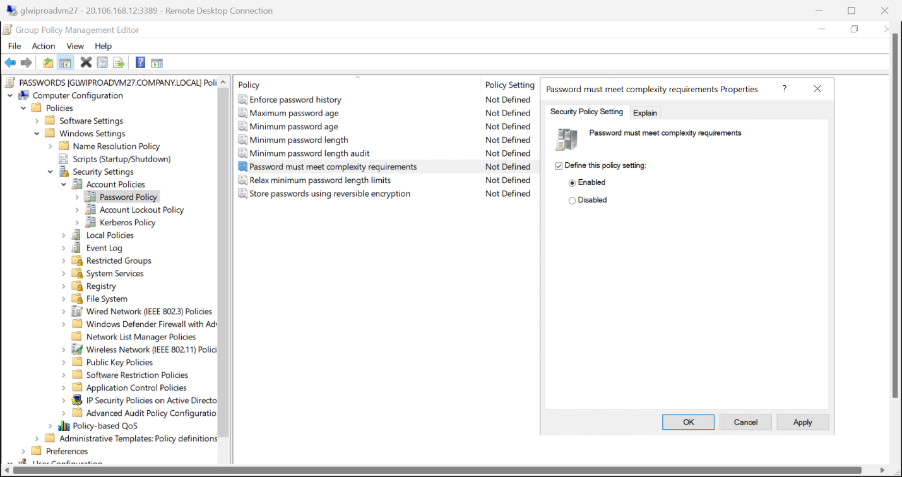
*Figure 39: Password must meet complexity requirements Properties with Enabled selected*

**Maximum password age** was set to **42 days**, so passwords expire.

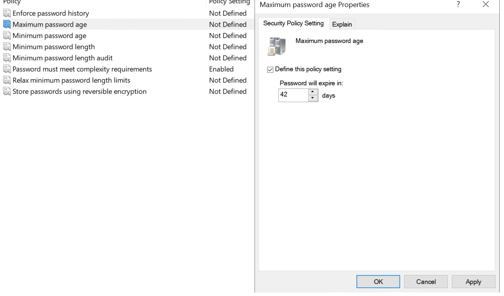
*Figure 40: Maximum password age Properties with the password set to expire in 42 days*

The resulting policy:

| Policy | Setting |
|---|---|
| Enforce password history | Not defined |
| Maximum password age | **42 days** |
| Minimum password age | **30 days** |
| Minimum password length | **5 characters** |
| Password must meet complexity requirements | **Enabled** |
| Store passwords using reversible encryption | Not defined |

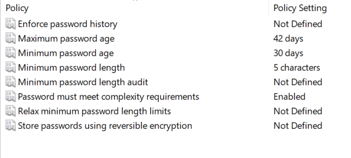
*Figure 41: Password Policy summary showing 42 day maximum age, 30 day minimum age, 5 character minimum length and complexity enabled*

> **Note:** a GPO only takes effect once it is **linked**. For domain-wide password rules, link it at the `company.local` domain level. Also see [Security Notes](#security-notes-and-improvements) for a stronger minimum length.

> **Objective:** Streamline user account setup while reducing IT overhead by delegating certain management tasks to department admins, keeping access to network resources secure and simple.

---

# Task 3: Group-Based Access Control with Delegation (15 points)

**Context:** The organization needs to manage access to internal resources (department folders and applications) using security groups in Active Directory, and to delegate control of group membership to department managers.

## 3.1 Create manager accounts

A manager account was created in each department OU. Each requires a password change at first logon.

| OU | Full name | Logon name |
|---|---|---|
| IT | IT MANAGER | `it_manager@company.local` |
| HR | HR MANAGER | `hr_manager@company.local` |
| SALES | SALES MANAGER | `sales_manager@company.local` |

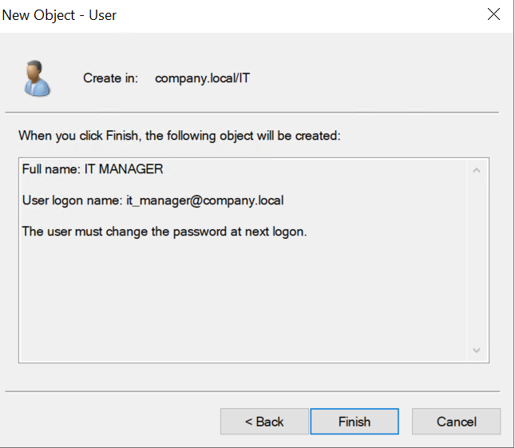
*Figure 42: Summary for the IT MANAGER account in company.local/IT*

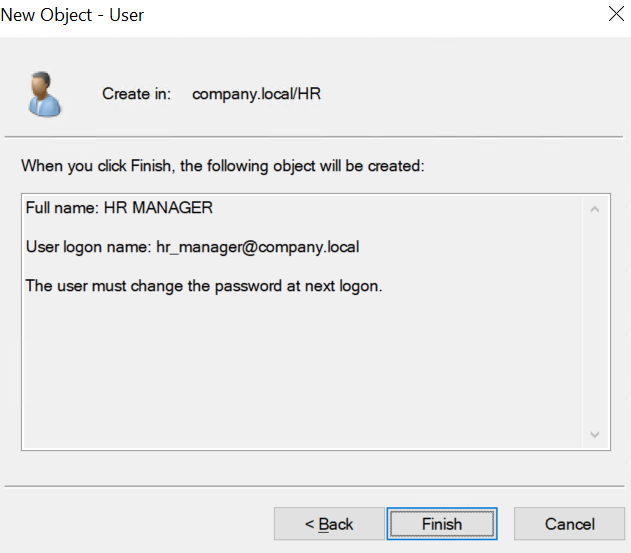
*Figure 43: Summary for the HR MANAGER account in company.local/HR*

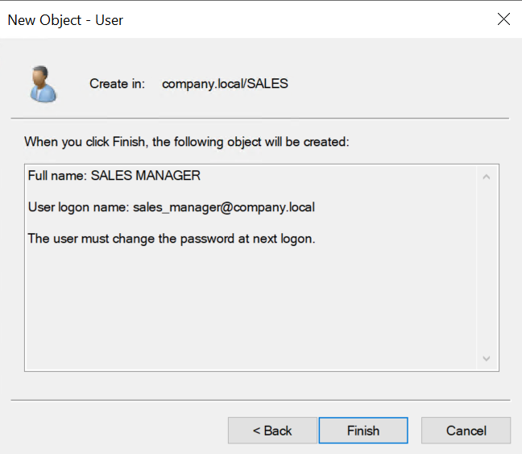
*Figure 44: Summary for the SALES MANAGER account in company.local/SALES*

## 3.2 Create department security groups

In each OU, **New > Group** was used to create a department group. All three are scope **Global** and type **Security**, which means they can be used to assign permissions.

| Group | OU | Scope | Type |
|---|---|---|---|
| IT GROUP | IT | Global | Security |
| HR GROUP | HR | Global | Security |
| SALES GROUP | SALES | Global | Security |

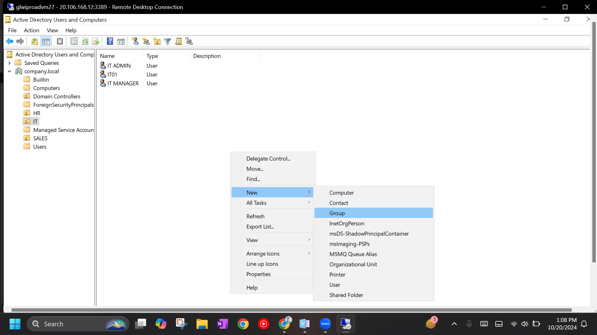
*Figure 45: Right-click menu in the IT OU with New and Group selected*

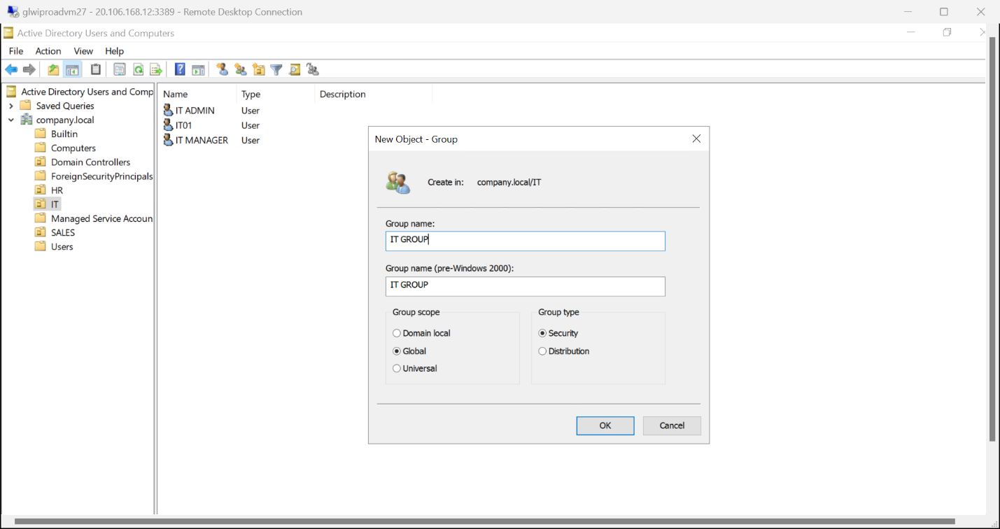
*Figure 46: New Object Group dialog creating IT GROUP*

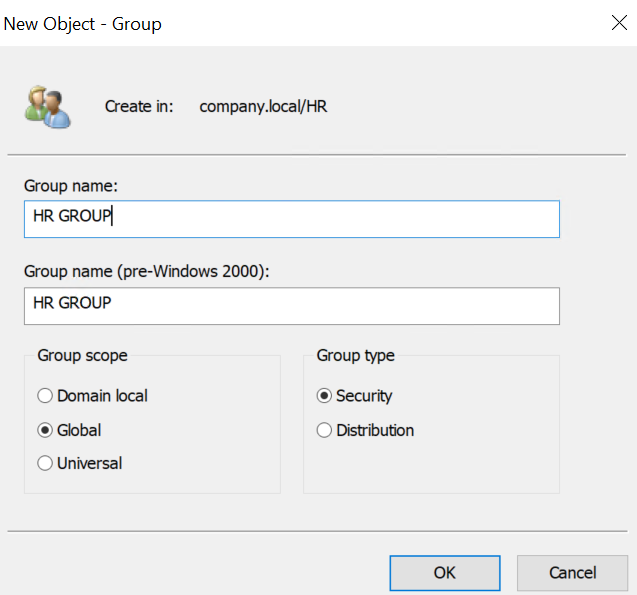
*Figure 47: New Object Group dialog creating HR GROUP*

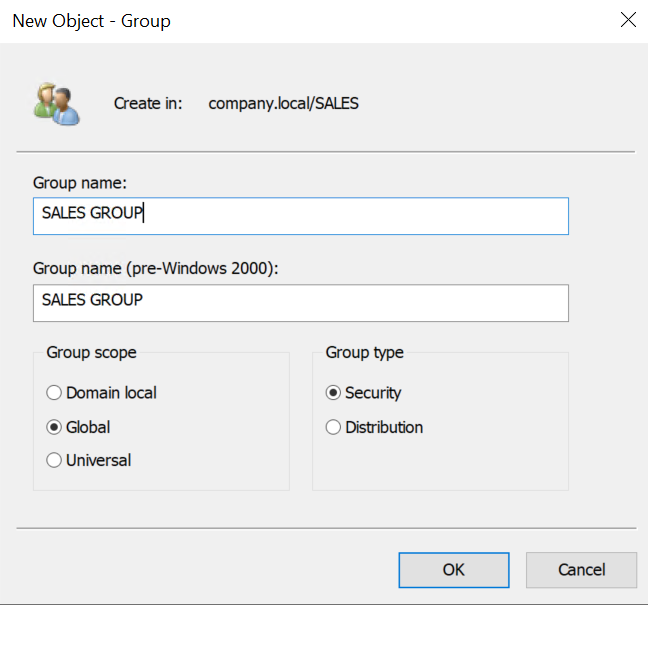
*Figure 48: New Object Group dialog creating SALES GROUP*

## 3.3 Add users to the groups

Users were added to the group that matches their department, so access follows job function. For example, in the IT OU the IT users were added to `IT GROUP`.

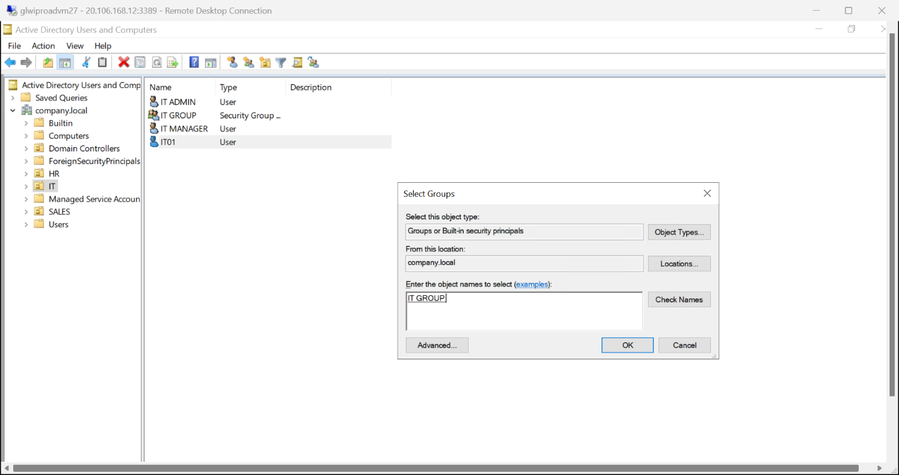
*Figure 49: Select Groups dialog with IT GROUP entered*

## 3.4 Delegate group membership management

The **Delegation of Control Wizard** was used on the **IT OU** so the IT manager can add and remove members of the department's groups without elevated rights.

1. Right-click the OU and choose **Delegate Control...**
2. On **Users or Groups**, click **Add...** and select the manager.
3. On **Tasks to Delegate**, choose **Modify the membership of a group**.

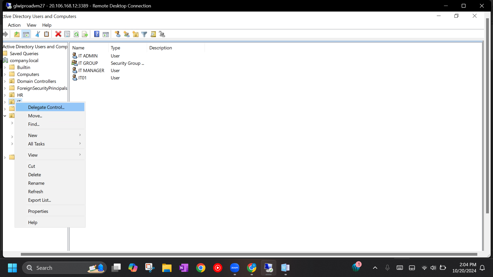
*Figure 50: Right-click menu on the IT OU with Delegate Control selected*

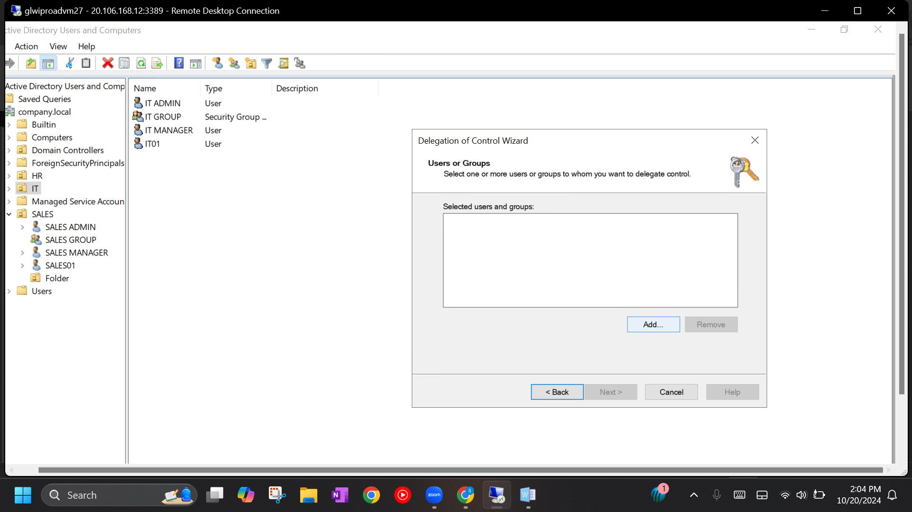
*Figure 51: Delegation of Control Wizard on the Users or Groups page with no users selected yet*

`IT MANAGER (it_manager@company.local)` was selected as the delegate.


*Figure 52: Select Users, Computers or Groups dialog with IT MANAGER entered*

The task **Modify the membership of a group** was ticked.


*Figure 53: Tasks to Delegate page with Modify the membership of a group ticked*

The SALES OU after its accounts and group were created:


*Figure 54: SALES OU showing SALES ADMIN, SALES GROUP, SALES MANAGER and SALES01*

## 3.5 Configure permissions on a shared folder

To show that group membership actually controls access, a folder named **SHARED FOLDER** was created on the server and shared with the IT group only.


*Figure 55: Server desktop with the SHARED FOLDER icon*

In **Properties > Sharing > Share...**, `IT GROUP` was added as a user allowed to access the share.


*Figure 56: Network access dialog with IT GROUP entered in Choose people to share with*

Windows confirms that the folder is shared and shows its network path.


*Figure 57: Network access confirmation that SHARED FOLDER is shared*

On the **Security** tab (NTFS permissions), `IT GROUP (COMPANY\IT GROUP)` has **Read & execute**, **List folder contents** and **Read**. It has no Modify or Write permission, which follows the principle of least privilege.


*Figure 58: SHARED FOLDER Properties Security tab with IT GROUP given Read and execute, List folder contents and Read*

| Principal | Permissions on SHARED FOLDER |
|---|---|
| IT GROUP (`COMPANY\IT GROUP`) | Read & execute, List folder contents, Read |
| Administrators | Administrative access (default) |
| SYSTEM | Default |

> **Objective:** Manage access to internal resources efficiently by organizing users into security groups, and reduce the administrative burden by delegating group management to department heads.

---

## Final Directory Layout

```text
company.local
├── Builtin
├── Computers
├── Domain Controllers
├── ForeignSecurityPrincipals
├── Managed Service Accounts
├── Users
├── HR
│   ├── HR ADMIN
│   ├── HR01
│   ├── HR MANAGER
│   └── HR GROUP
├── IT
│   ├── IT ADMIN
│   ├── IT01
│   ├── IT MANAGER
│   └── IT GROUP        ← membership managed by IT MANAGER (delegated)
└── SALES
    ├── SALES ADMIN
    ├── SALES01
    ├── SALES MANAGER
    └── SALES GROUP
```

## Security Notes and Improvements

This was built as a lab, so a few settings are deliberately simple. For anything beyond a lab:

- **Increase the minimum password length.** The lab policy uses 5 characters; 12 or more is recommended. Also define **Enforce password history**, and consider an account lockout policy.
- **Restrict RDP.** Use an Azure Network Security Group to limit port 3389 to your own IP address, or use Azure Bastion or just-in-time access instead of exposing RDP to the internet.
- **Never publish credentials.** Redact passwords, public IP addresses and subscription IDs from screenshots before sharing a repository publicly, and do not reuse lab passwords.
- **Use trusted certificates** instead of accepting the self-signed certificate warning.
- **Grant least privilege.** Delegate only the specific tasks needed (for example, *Reset user passwords* for a help desk, *Modify the membership of a group* for managers), never Domain Admin.
- **Keep protection on OUs** (*Protect container from accidental deletion*) and link GPOs deliberately.


## Skills:

- Azure resource group and virtual machine deployment
- Windows Server 2022 administration over RDP
- Installing and promoting AD DS, DNS and Global Catalog
- Organizational unit design
- User and group lifecycle management
- Group Policy (password complexity, age and length)
- Delegation of Control for least-privilege administration
- Group-based access control with NTFS and share permissions
